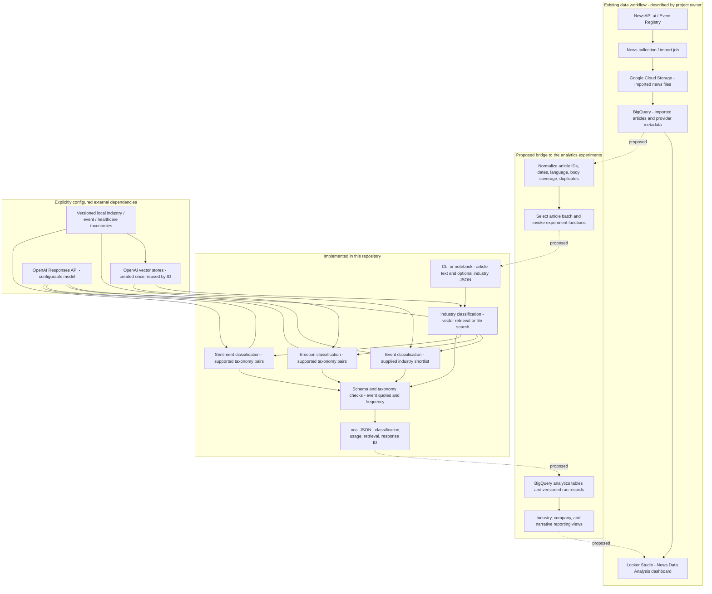

# Orcalytics architecture

The source is **NewsAPI.ai / Event Registry**, confirmed by the project owner during
this review. The owner described an existing import through Google Cloud Storage
and BigQuery into Looker Studio. The linked report opens as **News Data Analysis**.
The importer, bucket configuration, BigQuery schema, and report connector settings
were not available in this repository and were not independently inspected.

The diagram separates that existing data workflow from the experiment code now
consolidated on main. Dashed arrows are proposed integration work; they do not
claim that a deployed end-to-end enrichment pipeline already exists.

The Python API runs one task at a time. The arrows between classification stages
describe data dependencies; callers currently pass industry JSON explicitly.
There is no automatic cloud worker, batch scheduler, or BigQuery writer in this
refactor. Emotion/sentiment can alternatively retrieve candidate pairs directly
from the industry store, matching the original yusra experiments.

## What each layer contributes

| Layer | Responsibility | Evidence/status |
| --- | --- | --- |
| NewsAPI.ai | News text and enriched provider metadata | Provider confirmed by owner; actual collection configuration not inspected |
| Cloud Storage | Landing location for imported files | Owner-described; bucket names and import format unknown |
| BigQuery | Storage/querying for the imported dataset | Owner-described; tables, schema, and partitioning unverified |
| Looker Studio | Coverage, source, sentiment, concept, relevance, and duplicate analysis | Report and eight pages inspected; some embedded charts did not render |
| This repository | Article-level industry, event, emotion, and sentiment experiments | Implemented Python/CLI/notebooks; checked offline |
| Cloud integration | Feed selected BigQuery articles into experiments and persist results | Proposed, not implemented |
| Risk, trends, company intelligence | Longer-term analytics described in the project documents | Product direction; no implementation found in the original branches |

## Proposed data contracts for the cloud bridge

Use the actual BigQuery schema when implementing these contracts; the names below
are suggestions, not existing table names.

| Proposed dataset/table | Minimum role and fields |
| --- | --- |
| `raw_articles` | Preserve provider payload and article/source identifiers, original URL, collection timestamp, publication timestamp, language, title, body, and import object path. Keep provider concepts, sentiment, relevance, and duplicate fields under their original provenance. |
| `article_quality` | Article ID, body completeness/status, empty/partial body flags, body length, duplicate/canonical ID, parsing errors, and eligibility for LLM processing. |
| `analysis_runs` | Run ID, article ID/content hash, task, model, prompt/schema/taxonomy versions, response ID, token usage, processing timestamp, and success/failure details. |
| `article_industries` | One row per article/run/industry/subcategory, categorical relevance, explanation, and retrieval provenance. |
| `article_events` | One row per article/run/industry event, event type, exact evidence, sentiment, significance, confidence, and frequency. |
| `article_emotions` / `article_sentiments` | Per-industry outputs, retained taxonomy descriptors, support status, and run ID. Keep these separate from provider-level sentiment. |
| Reporting views | Aggregate only the intended eligible/canonical articles. Explicitly define timeframe, denominators, publication timezone, and whether counts refer to articles, sources, or industry assignments. |

Preserve source-level sentiment alongside Orcalytics industry-specific sentiment.
One article may affect two industries differently, so these fields have different
meanings. Provider concepts are useful entity/topic metadata but are not a reviewed
industry classification or ground truth for model evaluation.

Before applying the experiments to the imported dataset, inspect actual IDs,
timestamps, full-body coverage, source distribution, and duplicate semantics. Do not
overwrite raw content or discard duplicate relationships: narrative volume metrics
need to distinguish independent reporting from republished coverage.

The current industry implementation returns LOW/MEDIUM/HIGH relevance. Numeric
coverage/extent weights, trend aggregation, risk/stability scores, company graphs,
thesis monitoring, and production alerts remain future work. The healthcare emotion
and sentiment definitions must be expanded and evaluated before broader coverage.

See [the dashboard review](dashboard-review.md) for visible observations and metric
definition gaps, and [the branch analysis](branch-analysis.md) for code provenance.
